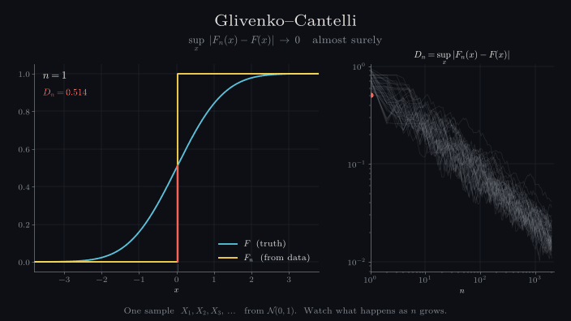

# mathstat-visual

**Mathematical Statistics, one theorem at a time — as code and animation.**



A visual, computational companion to a university course in Mathematical Statistics.
Every definition and theorem becomes an experiment: a small, tested function in
`src/`, and an animation in the spirit of 3Blue1Brown in `episodes/`.

The rule of the series: **a simulation never replaces a proof.** Each episode ends with
what the animation *cannot* show — and which step of the proof does that job instead.

## Episodes

| # | Topic | Status |
|---|---|---|
| 01 | Strong law of large numbers | planned |
| 02 | The empirical distribution | planned |
| 03 | [Glivenko–Cantelli](episodes/ep03_glivenko_cantelli.py) | ✅ |
| 04 | Shatter coefficients | planned |
| 05 | Intersections and quadrants | planned |
| 06 | The VC inequality, step by step | planned |
| 07 | From a bound to "almost surely" | planned |

The full plan, with predictions and limits for every episode: [docs/EPISODES.md](docs/EPISODES.md).

## Quickstart

```bash
git clone https://github.com/Aran737/mathstat-visual.git
cd mathstat-visual
python -m venv .venv && source .venv/bin/activate
pip install -e ".[dev]"

pytest                                            # check the maths
python episodes/ep03_glivenko_cantelli.py --preview   # a few PNG frames
python episodes/ep03_glivenko_cantelli.py             # mp4 + gif in media/
```

Rendering needs [ffmpeg](https://ffmpeg.org/) on your path.

## Structure

```
src/mathstat/   empirical.py   empirical distribution, empirical cdf, exact sup-distance
                shatter.py     traces and shatter coefficients
                bounds.py      Chebyshev, Hoeffding, VC bound
                style.py       colours and look of the series
tests/          the maths, checked: e.g. intervals give exactly n(n+1)/2 + 1 traces
episodes/       one script per animation
media/          rendered mp4 / gif
docs/           episode plan
```

Colours mean the same thing in every episode:
**blue** = truth · **yellow** = estimate from data · **red** = error · **green** = bounds.

## About

Built alongside the lecture *Mathematical Statistics* (Prof. Dr. Michael Kohler,
TU Darmstadt, winter term 2026/27). Statements are written in my own words; no
lecture material is reproduced here. Code under the MIT licence.
